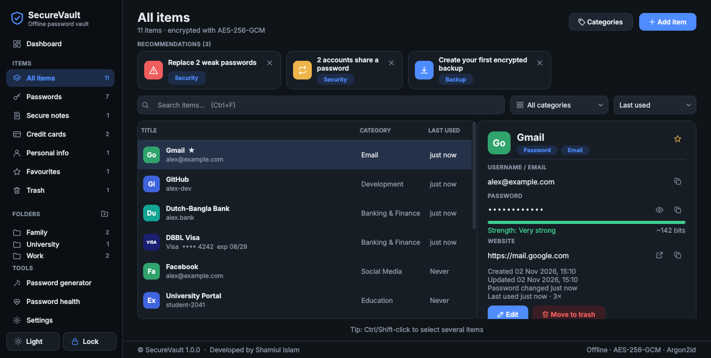

# SecureVault

[](https://github.com/Shamiul-693/SecureVault/actions/workflows/ci.yml)
[](https://github.com/Shamiul-693/SecureVault/releases/latest)
[](LICENSE)

**Developed by Md. Shamiul Islam**

## Download

Get **SecureVault.exe** from the [latest release](https://github.com/Shamiul-693/SecureVault/releases/latest) —
a single file, no installation or Python required. Windows SmartScreen may warn because the file isn't
code-signed: choose **More info → Run anyway**.



An offline desktop password manager for Windows 10/11, built with Python, PySide6 and SQLite.
No cloud, no telemetry, no network access — your vault never leaves your PC unless you copy a backup somewhere.

> **Honest security note.** SecureVault uses established, well-reviewed cryptography (Argon2id and
> AES-256-GCM from the `argon2-cffi` and `cryptography` libraries) and follows a careful design, but it has
> **not been independently security-audited**. Keep regular encrypted backups, and read *Threat model & limitations* below.

---

## 1. Quick start (Windows)

```bat
:: 1. Install Python 3.11+ from python.org (tick "Add python.exe to PATH")
:: 2. In the project folder:
build_exe.bat
:: -> creates .venv, installs dependencies, runs all tests, builds dist\SecureVault.exe
```

Run from source instead: `run_dev.bat` (or `python main.py` inside the activated venv).

### Manual setup

```bat
cd SecureVault
py -3.11 -m venv .venv
.venv\Scripts\activate
pip install -r requirements-dev.txt
python main.py                       :: run the app
set QT_QPA_PLATFORM=offscreen && python -m pytest -q   :: run the tests (59 tests)
pyinstaller --noconfirm --clean SecureVault.spec       :: build the EXE
```

The final executable is **`dist\SecureVault.exe`** — a single file, windowed (no terminal),
with the app icon and version details. It needs no Python installation on the target PC.

> The spec file is equivalent to `pyinstaller --noconfirm --clean --windowed --onefile --name SecureVault main.py`
> plus the icon, bundled resources, version info, and exclusion of unused Qt modules. UPX is disabled on purpose
> (UPX-packed EXEs often trigger antivirus false positives). A one-file EXE unpacks to `%TEMP%` at launch, so the first start
> takes a second or two.

### VS Code

1. Open the `SecureVault` folder. Install the recommended Python extension when prompted.
2. Run `build_exe.bat` once (or the manual setup) so `.venv` exists — `.vscode/settings.json` already points at it.
3. Press **F5** and choose:
   * **SecureVault (real data)** — your normal vault.
   * **SecureVault (throwaway test vault)** — uses `.devdata/` so you can experiment safely.
   * **Run tests** — the full pytest suite, headless.
4. The Testing sidebar discovers the pytest tests automatically.

---

## 2. Features

| Area | What you get |
|---|---|
| **Master password** | First-run setup with strength meter and rules, Argon2id key derivation, unlock screen, escalating lockout after 3 wrong attempts (5 s → 10 s → … max 5 min, persisted across restarts), change password, manual lock (sidebar or **Ctrl+L**), auto-lock after inactivity |
| **Dashboard** | Account and category counts, security score, weak/reused counts, recently added, recently updated, frequently used / favourites |
| **Items** | Add / edit / move to trash / view; search across name, username, URL and notes; filter by category; sort by name, created, updated or most-used; copy username / password / URL; show / hide password; open website (http/https only); favourites; right-click menu; **Del**, **Enter**, **Ctrl+C**, **Ctrl+F**, **Ctrl+N** |
| **Item types** | Passwords, **Secure notes**, **Credit cards** (cardholder, number, expiry, CVV, PIN — brand detection and checksum check) and **Personal info** (name, email, phone, address, ID…). Every field is encrypted |
| **Folders** | Create, rename (right-click) and delete folders in the sidebar; move one or many items into a folder |
| **Trash** | Deleted items go to the trash first; restore or delete forever; empty trash; items older than 30 days are purged automatically |
| **Recommendations** | Cards above *All items*: weak/reused/old passwords, missing or stale backup (one-click backup), auto-lock or clipboard clearing off — dismissible |
| **Item list** | Coloured initial avatars (drawn locally — no favicons are downloaded), card-brand tiles, Last used column, favourites, Ctrl/Shift multi-select with bulk move / favourite / trash |
| **Categories** | 10 defaults (Personal, Social Media, Email, Banking & Finance, Education, Work, Development, Shopping, Wi-Fi & Networks, Other) plus custom categories — add, rename, delete (accounts move to *Other*) |
| **Generator** | Length 8–128, upper/lower/digits/symbols, exclude ambiguous characters, guaranteed one of each chosen set, `secrets`-based, entropy and strength display, copy |
| **Security center** | Weak, reused and old passwords (threshold configurable), score out of 100, double-click to fix |
| **Backup & restore** | Encrypted `.svbak` backups, *Back up to…* any folder or USB drive, verify a backup, restore with automatic pre-restore safety backup, restore onto a fresh install from the setup screen |
| **Settings** | Auto-lock (1–60 min / never), clipboard clear (10–120 s / never), old-password threshold, change master password, lock now, dark / light theme, database location, integrity check |
| **Robustness** | Database integrity check at every start, damaged-file recovery flow, crash handler with log file, single-instance lock, atomic file writes |

**Keyboard:** Ctrl+1 dashboard · Ctrl+2 all items · Ctrl+3 generator · Ctrl+4 password health · Ctrl+5 settings · Ctrl+L lock · Ctrl+F search · Ctrl+N new account · Ctrl+R regenerate (generator) · Esc clears the unlock field.

---

## 3. Security architecture

### Key hierarchy

```
 master password ──Argon2id(salt 128-bit, 64 MiB, 3 passes, 4 lanes)──► KEK (256-bit, never stored)
                                                                         │
                                       AES-256-GCM wrap, AAD="securevault/vault-key/v1|"+salt
                                                                         ▼
                                       vault key (random 256-bit) ── stored ONLY in wrapped form
                                                                         │
                         AES-256-GCM per field, AAD="securevault/entry/v1|<entry-uuid>|<field>"
                                                                         ▼
                        title · url · username · password · notes  (each a separate ciphertext)
```

* **No password hash or verifier is stored.** A wrong master password is detected because the GCM
  authentication tag on the wrapped vault key fails to verify.
* **Changing the master password** derives a new KEK with a new salt and re-wraps the same vault key —
  entries are not re-encrypted, so the operation is fast and atomic.
* **Ciphertext format:** `version(1) ‖ nonce(12, random per encryption) ‖ ciphertext ‖ tag(16)`.
* **AAD binding:** moving a ciphertext into another row or column (a "swap" attack on the database file) fails
  authentication. Tampered entries are hidden and reported rather than crashing the app.
* **Argon2 parameters** are stored with the vault (so they can be raised later) and bounds-checked on load,
  so a tampered file cannot force a multi-gigabyte allocation.

### What is stored where

| Table | Contents | Encrypted? |
|---|---|---|
| `vault_metadata` | KDF params, salt, wrapped vault key, failed-attempt counter | Wrapped key is ciphertext; the rest is non-secret |
| `password_entries` | uuid, category id, 5 encrypted blobs, timestamps, use count, favourite flag | **All sensitive fields encrypted** |
| `categories` | category names, default flag | No (not credential data) |
| `application_settings` | theme, timeouts | No (no secrets) |

SQLite runs with `foreign_keys=ON`, `secure_delete=ON` (deleted content is overwritten inside the file),
`synchronous=FULL`, explicit `BEGIN IMMEDIATE` transactions and parameterised queries only.
`PRAGMA integrity_check` and `foreign_key_check` run at every start.

### Backups (`.svbak`)

```
"SVBACKUP" | version | header length | header JSON | AES-256-GCM(vault key, SQLite snapshot)
```

The header (KDF params, salt, wrapped vault key, creation date, SHA-256 of the snapshot) is authenticated as
**AAD**, so changing a single header byte invalidates the backup. Restoring verifies: password → GCM tag →
SHA-256 → SQLite integrity → schema. Only then is the current vault saved as a *pre-restore* backup and replaced
atomically. A backup always opens with **the master password that was active when it was made**.

### Other protections

* **Clipboard:** copied secrets are cleared after the configured timeout — only if the clipboard still holds
  what SecureVault put there. On Windows they are flagged to be excluded from *Clipboard History* (Win+V) and
  cloud clipboard sync. Locking or quitting clears it too.
* **Locking** wipes the vault-key buffer, closes open dialogs and destroys the main window with every decrypted
  value it was showing.
* **Logging** records events only (e.g. "Entry 12 updated"), never passwords, usernames, titles or keys.
  Logs: `%LOCALAPPDATA%\SecureVault\logs\securevault.log`.
* **Links:** only `http://` and `https://` URLs are opened — never `file://` or custom protocol handlers.
* **Generator** uses `secrets` (OS CSPRNG) with an unbiased shuffle.

### Threat model & limitations — please read

SecureVault protects your credentials **at rest**: someone who copies `vault.db` or a backup file cannot read it
without your master password, and Argon2id makes guessing expensive. It **cannot** protect you against:

* **Malware or a keylogger on your PC.** Anything that can watch your keyboard or read process memory while the vault is
  unlocked can steal secrets. Keep Windows and your antivirus updated.
* **A weak master password.** Offline attackers with the file are slowed by Argon2id but not stopped by the lockout
  (which only guards the UI). Use a long passphrase.
* **Python memory limitations.** Python strings are immutable, so decrypted values shown in the UI cannot be
  reliably zeroed; the vault key itself is kept in a wipeable buffer. Locking discards references, but traces may
  remain in RAM until reused, and could end up in the Windows page file or hibernation file.
* **Forgetting the master password.** There is no recovery by design.
* **No independent audit** has been performed.

---

## 4. Where your data lives

| Mode | Location |
|---|---|
| Normal (default) | `%LOCALAPPDATA%\SecureVault\` → `vault.db`, `backups\`, `logs\` |
| Portable | Put an empty file named **`portable.flag`** next to `SecureVault.exe` → data goes to `SecureVaultData\` beside the EXE (USB-stick use) |
| Override (dev/testing) | Environment variable `SECUREVAULT_DATA_DIR` |

Settings → *Data & storage* shows the exact path and has an *Open data folder* button.

## 5. Backup & restore guide

* **Create:** Settings → *Create backup* (saved to the backups folder) or *Back up to…* (pick a USB drive or
  another disk). Do this regularly and **keep at least one copy off the PC**.
* **Verify:** Settings → *Verify backup…* checks password, tamper-resistance and database integrity without
  changing anything.
* **Restore:** Settings → *Restore…* → confirm → enter the backup's master password. Your current vault is first
  saved as `pre-restore-<date>.svbak`, then replaced. The app locks; unlock with the backup's master password.
* **New PC / reinstall:** on the first-run setup screen choose *Restore from a backup…*.
* **Damaged database:** at start-up SecureVault offers to move the damaged file aside (kept as
  `vault.db.corrupt-<date>`, never deleted) and continue, so you can restore a backup.
* After **changing your master password**, create a fresh backup — older backups still use the old password.

---

## 6. Project structure

```
SecureVault/
├── main.py                    entry point
├── SecureVault.spec           PyInstaller build spec (one-file, windowed, icon, version info)
├── build_exe.bat              venv + install + tests + build
├── run_dev.bat                run from source
├── requirements.txt           runtime deps (pinned, tested)
├── requirements-dev.txt       + pytest, pyflakes, PyInstaller, Pillow
├── version_info.txt           Windows EXE version resource
├── app/
│   ├── config.py              paths (LOCALAPPDATA / portable), defaults, logging
│   ├── application.py         controller: lock state, auto-lock, theme, crash handler, run()
│   └── clipboard.py           clipboard copy + timed clearing + Win+V exclusion
├── core/                      pure Python, no Qt — fully unit-tested
│   ├── encryption.py          Argon2id, AES-256-GCM, key wrap, wipe
│   ├── authentication.py      setup, unlock, lockout, change password, password rules
│   ├── database.py            SQLite schema, transactions, categories, settings, ciphertext rows
│   ├── vault.py               encrypted CRUD, search / filter / sort
│   ├── password_generator.py  secrets-based generator
│   ├── security_analyzer.py   strength estimator, weak / reused / old analysis
│   └── backup_manager.py      .svbak create / verify / restore
├── ui/
│   ├── theme.py · icons.py · widgets.py · formatting.py
│   ├── login_window.py        setup + unlock screen
│   ├── main_window.py         sidebar, page stack, toasts, shortcuts
│   ├── dashboard.py · vault_page.py · generator_page.py · security_page.py · settings_page.py
│   └── account_dialog.py · category_dialog.py · dialogs.py
├── resources/icons/           app icon (.ico/.png), checkbox & combo glyphs
├── tools/make_icon.py         regenerates the app icon
└── tests/                     59 tests: crypto, auth, database, backup, generator/analyzer, UI startup
```

**How modules connect:** `main.py` → `app.application.run()` builds an `AppController`, which owns one
`Database`, `Authenticator`, `Vault`, `BackupManager` and `ClipboardManager`. UI widgets receive an `AppContext`
facade (services + theme + actions such as `lock()`, `copy_secret()`, `open_entry()`). The `core` package has no Qt
dependency, so all security logic is tested without a GUI.

## 7. Tests

```bat
set QT_QPA_PLATFORM=offscreen
python -m pytest -q
```

Covers: encryption round-trips, unique nonces, tamper and AAD-swap detection, wrong keys, Argon2 parameter bounds;
setup / unlock / wrong-password / persisted lockout / password change / master password never written to disk;
CRUD, no plaintext in the database file, SQL-injection resistance, transaction rollback, corrupted-file detection;
backup round-trip, wrong password, header and payload tampering, restore after password change, restore onto a fresh
install, failed restore leaves the vault untouched; generator rules and randomness; analyzer; and headless UI tests
for setup → unlock → lock (key wiped), every page and dialog, clipboard clearing, auto-lock, theme rebuild, URL scheme
filtering and damaged-database handling.

Tests use reduced Argon2 cost for speed; the application always uses the full parameters.

## Releasing a new version (maintainers)

1. Update `APP_VERSION` in `app/config.py` and `version_info.txt`.
2. Commit, then tag and push: `git tag v1.1.0 && git push origin v1.1.0`
3. GitHub Actions runs the tests on Windows, builds `SecureVault.exe` and publishes it on the Releases page.

## License

MIT © 2026 Md. Shamiul Islam — see [LICENSE](LICENSE).
